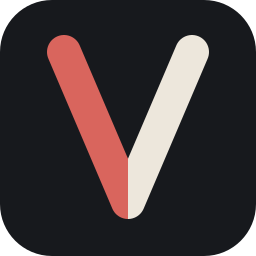

  

<h1 align="center">Velora Engine</h1>

An open-source narrative engine and VelScript toolchain, migrating from C++20 to C# / .NET 10.

  
  
  
  

**Project owner and current maintainer: [@imaginatorone](https://github.com/imaginatorone).**

> **Migration preview, not a finished C# visual novel player.** The legacy C++20
> application remains in this repository as a compatibility reference.
> The C# compiler, deterministic runtime, CLI, and independent service layers
> are implemented and tested. The full desktop Player, Editor, and export
> feature parity are **not yet complete**.

## The new C# architecture

Velora is being rebuilt as a modular, embeddable system for visual novels
and story-rich games. Its headless core does **not** need an SDL window,
graphics context, editor UI, or audio hardware.

| Component | Responsibility |
| --- | --- |
| \`Velora.Script.Syntax\` | Lossless lexer and recoverable syntax tree |
| \`Velora.Script.Semantics\` | Symbols, binding, source references, diagnostics |
| \`Velora.Script.Compiler\` | VelScript → immutable executable IR |
| \`Velora.Runtime\` + \`Velora.Runtime.Contracts\` | Dialogue, choices, conditions, state, events, deterministic execution |
| \`Velora.Cli\` | Validate and simulate scripts and projects headlessly |
| \`Velora.ProjectModel\` + \`Velora.Assets\` | Project manifests, asset resolution, path containment |
| \`Velora.Persistence\` | Compatible v1/v2 reads and v2 save writes |
| \`Velora.Localization\` | Localized story text and catalog selection |
| \`Velora.Audio\` + \`Velora.Audio.Miniaudio\` | Audio requests, isolated native audio adapter |
| \`Velora.Rendering.Abstractions\` + \`Velora.Rendering.Sdl\` | Rendering state and emerging SDL backend |
| \`Velora.Text\`, \`Velora.UI\`, \`Velora.Platform.*\` | Typewriter, UI contracts, host/platform services |

**C# works today for narrative runtime integration**, e.g. Godot .NET,
but the host must supply UI, input, graphics, and its own audio presentation.

## Get started (C# preview)

Requirements: **.NET SDK 10.0.403**, pinned in \`global.json\`.

\`\`\`sh
git clone https://github.com/imaginatorone/velora.git
cd velora
dotnet restore Velora.sln --locked-mode
dotnet build Velora.sln -c Debug --no-restore
dotnet test --solution Velora.sln -c Debug --no-build --no-restore
\`\`\`

Validate and run the sample without a graphical application:

\`\`\`sh
dotnet run --project src/Velora.Cli -- validate samples/KitchenSink/game.velproj
dotnet run --project src/Velora.Cli -- simulate samples/KitchenSink/game.velproj --input Reader
\`\`\`

Embed the compiler/runtime through C# project references to
\`Velora.Script.Syntax\`, \`Velora.Script.Semantics\`,
\`Velora.Script.Compiler\`, \`Velora.Runtime\`, and their referenced
projects. The host uses \`SyntaxTree.ParseText\` →
\`SemanticModel.Create\` → \`VeloraCompiler.Compile\` →
\`StoryRuntime.Start/Advance/SelectChoice\`, then renders its events/state.

See [Godot integration](docs/INTEGRATIONS_GODOT.md) for an actual host
integration pattern, and [C# testing](docs/TESTING_CSHARP.md) for detailed
build/test instructions.

## VelScript example

\`\`\`text
character guide = "Guide" color: #8FB3A2

label start:
    guide "You're not alone here."
    menu:
        "Stay":
            guide "Then let us begin."
        "Leave":
            guide "Until next time."
    end
\`\`\`

Velora supports choices, conditions, character speech, variables,
localization, and narrative intents. See the
[VelScript reference](docs/velscript.md) and
[sample project](samples/KitchenSink).

## Legacy C++ build

The existing C++20/SDL3 player is still available while compatibility work
continues. It is **not** the recommended starting point for new integrations:

\`\`\`sh
cmake --preset release
cmake --build --preset release --parallel
ctest --preset release -C Release
\`\`\`

Legacy platform prerequisites and packaging are in [BUILDING.md](BUILDING.md).
Do not delete or rewrite compatibility tests just to make migration green.

## Migration and project status

- [Current implementation status](docs/migration/STATUS.md)
- [Architecture](docs/migration/ARCHITECTURE.md)
- [Roadmap and gates](docs/migration/ROADMAP.md)
- [Compatibility decisions](docs/migration/COMPATIBILITY.md)
- [Contributing](CONTRIBUTING.md) · [Governance](GOVERNANCE.md) ·
  [Security](SECURITY.md) · [Third-party notices](THIRD_PARTY_NOTICES.md)

## Ownership and license

Velora is owned and currently maintained by **imaginatorone**.
Historical contributors and copyright notices remain traceable through Git
history and the existing [MIT license](LICENSE); current maintenance roles
are independent of prior contributions.
